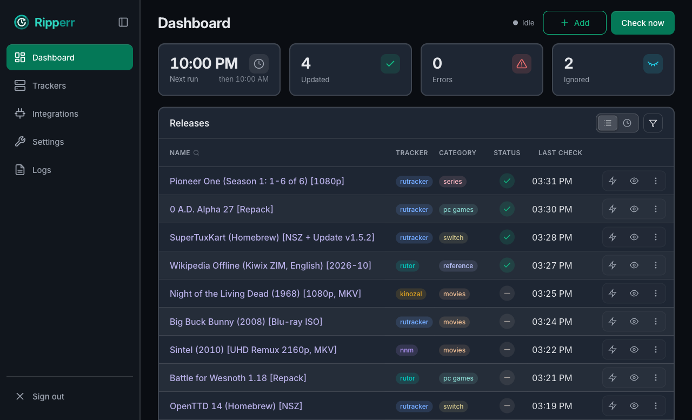

<div align="center">

# 📽️ Ripperr 📽️


[English](README.md) · [Changelog](CHANGELOG.md)

Раздачи с форумных трекеров сами обновляются до актуальных.

Когда в раздачу на форумном трекере добавили серии, звуковую дорожку или новую версию игры, Ripperr
скачивает новый торрент и заменяет им старый в клиенте.



</div>

---

## Зачем Ripperr

Форумные трекеры обновляют раздачу в той же теме. В теме просят заново скачать торрент-файл и
перепроверить задачу в клиенте. Клиент при этом раздает старый торрент, и узнаешь об обновлении,
когда сезон уже вышел целиком. Ripperr сам скачивает новый `.torrent` и запускает перепроверку.

## Рядом с Sonarr, Radarr и мониторами тем

Sonarr, Radarr и похожие программы ищут раздачи и отправляют их в клиент. За темой на форуме, где
серии добавляются в тот же торрент, они не следят: Sonarr видит, что загрузка уже импортирована, и
пропускает ее. Ripperr следит за всеми торрентами в выбранных категориях или тегах, кто бы их ни
добавил: Sonarr, Radarr, Prowlarr или вы сами.

Monitorrent и TorrentMonitor тоже обновляют раздачи, но им нужен список ссылок на темы, и этот
список вы ведете вручную. Ripperr берет все из torrent-клиента:

- Трекеры пишут ссылку на тему в комментарий торрента. Ripperr читает ее у торрентов из выбранных
  категорий или тегов, так что торрент попадает под наблюдение сразу, как вы добавили его в клиент.
- Новая версия получает тот же путь сохранения, категорию, теги и выбор файлов. Ripperr проверяет
  новый торрент до того, как убрать старый, а если упадет посередине, доделает замену при
  следующем запуске. Старые файлы удаляются только там, где вы это разрешили. Если новая версия не
  помещается на диск, старый торрент остается, приходит уведомление, и Ripperr пробует снова при
  следующей проверке.
- Cloudflare проходит через FlareSolverr, мертвые домены заменяет зеркалами, темы только с
  magnet-ссылкой скачивает через пиров.
- Это один контейнер и один файл SQLite, веб-интерфейсом можно пользоваться с телефона.

## Поддерживаемые трекеры

RuTracker, Kinozal, Rutor, NNM-Club, TeamHD, Toloka, Tapochek, Riper.AM, BookTracker, AniDub,
AnimeLayer, AniLiberty, Selezen, Rustorka, NewStudio.

Torrent-клиенты: qBittorrent, Transmission, Deluge, Synology Download Station (без тегов; при замене
новая версия скачивается целиком, старые файлы остаются).

## Что еще умеет

- Уведомления в Telegram, на email, в Pushover, в webhook или push в браузер.
- Частота проверок зависит от возраста раздачи: свежие проверяются часто, старые редко. Сломанные
  темы уходят в игнор.
- Пробный прогон: полный проход, который показывает, что изменится, и ничего не меняет.
- Принудительная проверка одной раздачи или всех сразу с панели.
- Логины и токены хранятся в зашифрованном виде. Метрики Prometheus, `/healthz` и `/readyz`.
- Интерфейс на английском и русском.

## Запуск

Образ на [Docker Hub](https://hub.docker.com/r/nortido/ripperr) собран для amd64 и arm64.

```bash
docker run -d --name ripperr -p 6410:6410 -v ./config:/config nortido/ripperr
```

Откройте `http://<host>:6410` и создайте учетную запись. Это можно сделать только из локальной
сети, поэтому создайте ее до того, как откроете порт наружу. Потом подключите torrent-клиент,
добавьте трекеры, выберите категории или теги и начните с пробного прогона.

Сохраняйте `secrets.key` вместе с `ripperr.db` из папки конфигурации. Без ключа Ripperr не сможет
прочитать сохраненные пароли.

## Сборка

Go 1.25 или новее.

```bash
go build -o ripperr ./cmd
go test ./...
```

`docker build -t ripperr .` собирает образ для вашей платформы, `make build-multi` собирает его для amd64 и arm64.

## Лицензия

GNU Affero General Public License v3.0.

Ripperr не размещает и не индексирует контент. Он работает только с торрентами, которые у вас уже
есть, на трекерах, где у вас есть доступ. За то, что вы скачиваете, отвечаете вы.
